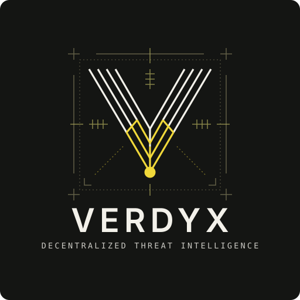
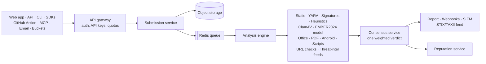

<p align="center">
  <a href="https://verdyx.dev"></a>
</p>

<h1 align="center">Verdyx</h1>

<p align="center">
  <strong>Open-source malware, URL and email analysis.</strong><br/>
  Many engines look at every file and link, and one verdict you can audit comes back, with each engine's evidence attached.
</p>

<p align="center">
  <a href="https://verdyx.dev"><strong>Website</strong></a> ·
  <a href="docs/API.md"><strong>API</strong></a> ·
  <a href="https://verdyx.dev/benchmark"><strong>Benchmark</strong></a> ·
  <a href="https://verdyx.dev/architecture"><strong>Architecture</strong></a> ·
  <a href="docs/"><strong>Docs</strong></a>
</p>

<p align="center">
  <a href="https://github.com/deep60/Verdyx/actions/workflows/rust.yml"></a>
  <a href="https://github.com/deep60/Verdyx/actions/workflows/frontend-ci.yml"></a>
  <a href="https://github.com/deep60/Verdyx/actions/workflows/codeql.yml"></a>
  <a href="./LICENSE"></a>
  
  
</p>

---

## Why Verdyx

A single antivirus engine misses things, and a single "malicious" label doesn't say why. Verdyx sends every file, URL and email through a set of independent engines: YARA, ClamAV, a Windows-program model trained on EMBER2024, document and app analyzers, threat-intelligence feeds and more. A **consensus service** weighs what each one found and turns it into one verdict.

- **Clear evidence.** Every report shows which engines voted, what each one found, and how much each vote counted. Engines that aren't ready are shown as advisory and never counted.
- **Measured in the open.** Detection is benchmarked on real malware and clean files, and the [results are published](https://verdyx.dev/benchmark), including what it misses.
- **Yours to run.** Use the hosted service at [verdyx.dev](https://verdyx.dev), or run the whole stack on your own server with Docker Compose. Uploaded files are private by default.

## What it does

<table>
<tr>
<td width="50%" valign="top">

**🔬 File analysis**
- Windows, Linux and macOS programs: structure, entropy, strings, imports and indicators
- Office documents: VBA and Excel 4.0 macros, remote templates, Follina links, DDE
- PDFs: JavaScript, launch actions, embedded files, credential-leaking links
- Android apps: permissions, risky APIs, packers, banking-trojan and spyware patterns
- Scripts: undoes obfuscation (split strings, character codes, base64, hex, compression) before scanning
- Archives opened two levels deep, including `infected`-password zips

</td>
<td width="50%" valign="top">

**🌐 URL and email analysis**
- Follows redirects and checks TLS, look-alike domains and misused brand names
- URLhaus and ThreatFox (abuse.ch), Google Safe Browsing and VirusTotal
- Domain age from RDAP
- Emails: SPF, DKIM and DMARC, every attachment scanned, and links checked
- Each lookup reports its own result and its own time

</td>
</tr>
<tr>
<td valign="top">

**🎯 Hunting and intelligence**
- YARA retrohunts over past uploads, and live hunts on every new one
- Similar files found by TLSH, ssdeep and imphash
- Indicators published as STIX 2.1 over TAXII 2.1, for OpenCTI, MISP and others
- Behaviour reports from the VirusTotal sandbox

</td>
<td valign="top">

**🏢 Built for teams**
- Teams with roles, invitations, team scans and team API keys
- Single sign-on (OpenID Connect) and SCIM provisioning
- Append-only audit log, data retention, deletion and full export
- Signed, retried webhooks; events sent to Splunk and Microsoft Sentinel
- Scans files as they land in S3, R2, Google Cloud Storage and other S3-compatible buckets

</td>
</tr>
</table>

## How it works



1. **Submit.** A file, URL or email arrives from the web app, the API, a CLI or SDK, the GitHub Action, an AI assistant (MCP), or a connected bucket.
2. **Analyze.** The analysis engine runs every engine that applies. Each one returns a verdict, a confidence and the evidence behind it.
3. **Decide.** The consensus service weighs the votes. A known-malware hash match decides alone; otherwise the majority of counted votes wins, and strong evidence such as a VirusTotal or ClamAV detection outweighs engines that found nothing.
4. **Deliver.** The report is saved and shown, and signed webhooks, SIEM events and the threat feed are sent.

See it animated on the [architecture page](https://verdyx.dev/architecture).

## Detection benchmark

Measured on **197 malware samples** and **2,038 clean files**, with known-malware hash lookups turned off so the engines can't simply look the samples up:

| | Result |
|---|---|
| Malware flagged | **123 of 197 (62.4%)** |
| Clean files wrongly flagged | **6 of 2,038 (0.29%)** |

Detection is improving with each release. The full results, broken down by engine and file type, are at [verdyx.dev/benchmark](https://verdyx.dev/benchmark). The method and scripts are in [`backend/analysis-engine/benchmark`](backend/analysis-engine/benchmark).

## Quick start

### 1. Use the hosted service

Go to [verdyx.dev](https://verdyx.dev), sign up, and drop in a file or URL. To use it from code, create an API key on your profile page (**API keys** tab) with the `read` and `scan` scopes.

### 2. Call the API

```bash
curl -X POST https://api.verdyx.dev/api/v1/submissions/file \
  -H "X-API-Key: $VERDYX_API_KEY" \
  -F "file=@suspicious.exe"
```

Full reference: [`docs/API.md`](docs/API.md) · OpenAPI spec: [`docs/api/openapi.yaml`](docs/api/openapi.yaml)

### 3. Use a client

| Client | Example |
|---|---|
| [`verdyx` CLI and JS/TS SDK](sdk/typescript) | `verdyx scan --fail-on suspicious dist/*.exe https://example.com` |
| [Python SDK](sdk/python) | `Verdyx().scan("sample.exe").verdict` |
| [GitHub Action](action) | Scan build artifacts and fail the job on a bad verdict |
| [MCP server](sdk/typescript#mcp-server-for-ai-assistants) | `verdyx mcp` lets Claude, Cursor and other AI assistants scan files and links |

<details>
<summary><strong>Gate a CI pipeline with the GitHub Action</strong></summary>

```yaml
- uses: deep60/Verdyx/action@main   # pin to a commit SHA for anything that matters
  with:
    api-key: ${{ secrets.VERDYX_API_KEY }}
    paths: |
      dist/**/*.exe
      dist/**/*.dll
```

</details>

### 4. Run it yourself

Requires Docker with the Compose plugin.

```bash
git clone https://github.com/deep60/Verdyx.git && cd Verdyx
cp .env.example .env        # then set the passwords and JWT_SECRET
docker compose up -d
```

- Web app: <http://localhost:5001>
- API health: <http://localhost:8080/api/v1/health>

For development setup, tests and production deployment, see [`docs/deployment/local-setup.md`](docs/deployment/local-setup.md) and [`docs/deployment/production.md`](docs/deployment/production.md).

## Engines

| Engine | What it does | Counts toward the verdict |
|---|---|---|
| Hash lookup | MalwareBazaar match on the file's hash | ✅ |
| Static analysis | Program structure, entropy, strings, imports, indicators | ✅ |
| YARA | [YARA Forge](https://github.com/YARAHQ/yara-forge) core pack, updated weekly, plus Verdyx's own rules | ✅ |
| Signatures and heuristics | Byte signatures and scored behaviour patterns | ✅ |
| ClamAV | Open-source antivirus | ✅ |
| Windows program model | LightGBM model trained on EMBER2024 | ✅ |
| Office, PDF, Android and script analyzers | Format-specific deep inspection | ✅ |
| URL checks and threat-intel feeds | Redirects, TLS, look-alikes, URLhaus, ThreatFox, Safe Browsing, VirusTotal | ✅ |
| General ML classifier | Hand-set weights, not trained yet | Advisory only |

The live status of every engine is at `GET /api/v1/engines`.

## Architecture

A Rust workspace of small services behind one gateway, with Postgres, Redis and S3-compatible storage.

| Service | Responsibility |
|---|---|
| [`api-gateway`](backend/api-gateway) | Public API, teams, API keys, SSO and SCIM, plans and quotas, webhooks, SIEM and the TAXII feed |
| [`user-service`](backend/user-service) | Accounts and sign-in |
| [`submission-service`](backend/submission-service) | Accepting files, URLs and emails, and storing them |
| [`analysis-engine`](backend/analysis-engine) | Running every engine and collecting the evidence |
| [`consensus-service`](backend/consensus-service) | Weighing the votes into one verdict |
| [`reputation-service`](backend/reputation-service) | Engine and analyst accuracy over time |
| [`notification-service`](backend/notification-service) | Email and webhook notifications |

The web app is React and TypeScript, built with Vite and Tailwind and served from Cloudflare Pages. More in [`docs/architecture`](docs/architecture).

<details>
<summary><strong>Analyst marketplace (testnet)</strong></summary>

Verdyx also has an experimental marketplace where analysts stake on verdicts for bounties, paid in a test token. The contracts in [`blockchain/`](blockchain) are deployed to the **Base Sepolia testnet** only. They are checked with Slither and Mythril but have **not** had an external audit. Every transaction is signed from the user's own wallet; no Verdyx service holds a signing key.

</details>

## Plans

| | Free | Team | Enterprise |
|---|---|---|---|
| Scans per person | 100 a day | 2,000 a day | 20,000 a day |
| Team scans per month | No limit | 50,000 | As agreed |
| Members | 50 | 200 | 1,000 |
| Storage connections | 5 | 10 | 25 |

Details: [`docs/plans.md`](docs/plans.md) · [verdyx.dev/pricing](https://verdyx.dev/pricing)

## Repository layout

```
backend/         Rust services (gateway, analysis engine, consensus, …)
frontend/        Web app (React, TypeScript, Vite)
sdk/             verdyx CLI, JS/TS and Python SDKs
action/          GitHub Action
ml/              Model training (EMBER2024)
blockchain/      Marketplace contracts (Solidity, Hardhat)
infrastructure/  Kubernetes, Terraform, Ansible, Caddy
monitoring/      Prometheus, Alertmanager, Grafana
docs/            Architecture, API, deployment and operations guides
```

## Documentation

- [Architecture](docs/architecture): system design and data flow
- [API reference](docs/API.md): every route, with examples
- [Engines](docs/engines): supported engines and the consensus specification
- [Integrations](docs/integrations): SSO, Splunk, Sentinel, email and cloud storage
- [Deployment](docs/deployment) and [operations](docs/operations): running Verdyx in production
- [Security](docs/security): threat model and incident response

## Contributing

Contributions are welcome, from new YARA rules and signatures to whole engines. Read [`CONTRIBUTING.md`](CONTRIBUTING.md) to get started.

## Security

Please **don't open a public issue** for a vulnerability. Report it privately through [GitHub's security advisories](https://github.com/deep60/Verdyx/security/advisories/new).

## License

[MIT](LICENSE) © Verdyx
