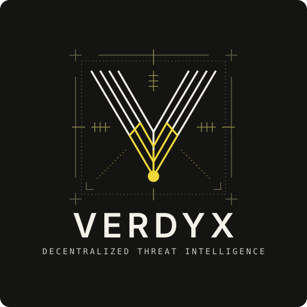

<p align="center">
  
</p>

<h1 align="center">Verdyx</h1>

<p align="center">
  <strong>A decentralized threat intelligence marketplace.</strong><br/>
  Crowdsourced analysts and automated engines compete to verify malware and phishing threats — backed by staked, on-chain incentives.
</p>

<p align="center">
  <a href="./LICENSE"></a>
  
  
  
</p>

---

## Overview

Traditional threat detection relies on single-vendor engines, which creates blind spots, slow zero-day response, and no accountability for bad calls. Verdyx replaces that with an open marketplace:

1. A file, URL, or hash is **submitted** with a bounty.
2. Human analysts and automated engines **stake tokens** on a verdict (malicious / benign).
3. Verdicts are aggregated by a **consensus service** into a confidence score.
4. Accurate submitters **earn the bounty and reputation**; inaccurate ones **lose their stake**.

> **Status:** slashing exists in the contracts, but the backend still records stake penalties off-chain only. Contracts have had no external audit and are not yet deployed to a public network.

The result is a threat feed where every verdict has skin in the game, priced and settled on-chain.

### Backend services (`backend/`)

Rust workspace, one crate per domain:

| Service | Responsibility |
|---|---|
| `api-gateway` | Auth (JWT), request routing, rate limiting, public API surface |
| `user-service` | Identity, profiles, auth workflows |
| `submission-service` | Threat submissions, analyst votes/verification |
| `bounty-manager` | Bounty lifecycle, on-chain escrow integration |
| `consensus-service` | Verdict aggregation and confidence scoring |
| `reputation-service` | Analyst/engine scoring and leaderboards |
| `payment-service` | Payouts and treasury transactions |
| `analysis-engine` | Automated scanning and enrichment pipeline |
| `notification-service` | Outbound notifications (email/webhook) |
| `shared` | Common types, config, and utilities |

### Smart contracts (`blockchain/`)

Solidity contracts (Hardhat), with Slither and Mythril static analysis configs included (no external audit yet):

- `ThreatToken` — the ERC-20 staking/reward token
- `BountyManager` — escrow, staking, and bounty settlement
- `ReputationSystem` — on-chain analyst/engine reputation
- `Governance` — protocol parameter governance

### Detection status

| Engine | Status |
|---|---|
| YARA, signatures, static, heuristic, hash lookups | Real, with a small starter rule set |
| ClamAV | Real, but disabled on the 1 GB production box because it needs about 1.5 GB of RAM |
| ML | Hand-set weights, not trained on data. Expect false positives on compressed files and executables |
| IP and domain reputation | Simulated placeholder, needs a real threat feed |

### Frontend (`frontend/`)

React + TypeScript + Vite, Tailwind + shadcn/ui, using the **Aurora** design system (dark violet/indigo with an indigo→magenta brand gradient).

### Infrastructure (`infrastructure/`)

Terraform (AWS), Kubernetes manifests per service, Ansible playbooks, and Docker configs for local/dev/production deployment.

## Getting Started

### Prerequisites

- [Node.js](https://nodejs.org/) 18+
- [Rust](https://www.rust-lang.org/tools/install) (stable toolchain)
- [Docker](https://www.docker.com/) + Docker Compose
- An Ethereum wallet (e.g. [MetaMask](https://metamask.io/)) for on-chain interactions

### Local development

```bash
git clone https://github.com/deep60/Verdyx.git
cd Verdyx

# Full stack (Postgres, Redis, all services, frontend)
docker compose up -d

# Or run pieces individually:

# Backend services
cd backend
cargo run --bin api-gateway

# Frontend
cd frontend
npm install
npm run dev

# Smart contracts (local Hardhat node)
cd blockchain
npm install
npx hardhat node
npx hardhat run scripts/deploy.ts --network localhost
```

Full setup instructions: [`docs/deployment/local-setup.md`](docs/deployment/local-setup.md).

### Running tests

```bash
# Backend
cd backend && cargo test

# Frontend
cd frontend && npm run test        # unit (Vitest)
cd frontend && npm run test:e2e    # e2e (Playwright)

# Smart contracts
cd blockchain && npx hardhat test
```

## API

The gateway exposes a REST API under `/api/v1` (auth, bounties, submissions, wallet, webhooks). See [`docs/API.md`](docs/API.md) for the full route reference and [`docs/api/openapi.yaml`](docs/api/openapi.yaml) for the OpenAPI spec.

```bash
curl -X POST https://api.verdyx.com/api/v1/bounties \
  -H "Authorization: Bearer <TOKEN>" \
  -F "file=@/path/to/sample.exe" \
  -F "bounty=0.05"
```

## Documentation

- [`docs/architecture/`](docs/architecture) — system design and data flow
- [`docs/deployment/`](docs/deployment) — local, Kubernetes, and production runbooks
- [`docs/development/`](docs/development) — code style, testing, contributing guidance
- [`docs/security/`](docs/security) — threat model and incident response

## Contributing

Contributions are welcome — see [`CONTRIBUTING.md`](CONTRIBUTING.md) for guidelines and coding standards.

## Security

If you discover a security vulnerability, please **do not open a public issue**. Report it privately as described in [`docs/security/`](docs/security).

## License

[MIT](LICENSE) © Verdyx
