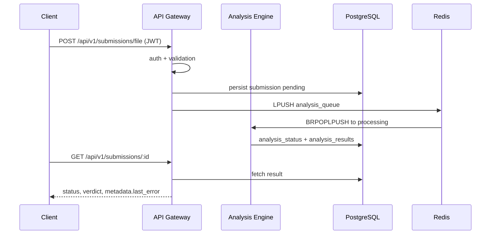

# Data Flow

## 1. Authentication Flow

1. Client sends credentials to `POST /api/v1/auth/login`.
2. API gateway validates credentials and issues JWT/refresh token.
3. Client sends `Authorization: Bearer <jwt>` on protected routes.
4. Middleware validates token and injects claims into request context.

## 2. Bounty Flow

1. Client creates bounty with `POST /api/v1/bounties`.
2. Gateway validates payload and user context.
3. Bounty manager validates policy and on-chain prerequisites.
4. DB state is updated and result returned to client.

## 3. Analysis Submission Flow

The dashboard path is `POST /api/submissions/file`, not a second writer in submission-service. See `service-ownership.md` for the full trace, retry rules, and which service owns each table.

1. Client submits via `POST /api/submissions/file` with a Bearer JWT.
2. Gateway authenticates, persists the submission as `pending`, and pushes the id onto Redis `analysis_queue`.
3. The analysis-engine worker claims the id onto `analysis_queue:processing`, scans, and writes `analysis_status` plus `analysis_results` on that same row.
4. Status is read back with `GET /api/submissions` or `GET /api/submissions/:id`. `metadata.last_error` carries the last worker diagnostic.

## 4. Read Flows

- `/api/v1/bounties`, `/api/v1/analysis`, and reputation routes read from PostgreSQL with optional cache assist from Redis.

## 5. Health and Operations Flow

- Gateway health endpoints (`/health`, `/health/ready`, `/health/live`) are used by scripts and orchestrators for readiness/liveness checks.

## Mermaid: Request-to-Analysis Path

